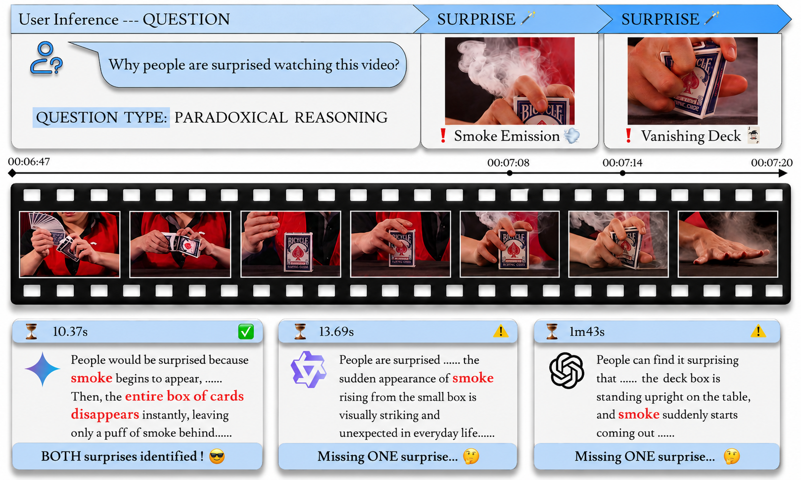

<div align="center">

<h1>&nbsp;The Prestige:</h1>

<h3>Benchmarking Cognitive Visual Reasoning using Magic Tricks</h3>

Accepted at **NeurIPS 2026 · Track on Evaluations and Datasets** 🎉

[📄 Paper](https://arxiv.org/abs/2610.38103) | [🌐 Website](https://stevvwen.github.io/prestige-website/) | [🤗 Dataset](https://huggingface.co/datasets/SediRockStar/The_Prestige)

</div>



The Prestige is a video question-answering benchmark built from professional magic performances. Magicians deliberately misdirect their audience, so the questions take more than object recognition. A model has to track objects through a long routine, remember what was shown earlier, explain why a reveal surprises the audience, and reject questions that rest on false premises.

The benchmark has **2,177 open-ended questions** in six categories. Each question is anchored to a timestamp in a YouTube video and has a human-written reference answer. The best model in the paper, Gemini 3.1 Pro, scores 47.08%. Humans score 92.79%.

## Repository layout

```
The_Prestige/
├── UID1000_reviewed.json   # UIDs 1–1291,    589 questions
├── UID2000_reviewed.json   # UIDs 2000–2534, 434 questions
├── UID3000_reviewed.json   # UIDs 3000–3384, 380 questions
├── UID4000_reviewed.json   # UIDs 4000–4329, 330 questions
└── UID5000_reviewed.json   # UIDs 5000–5550, 444 questions
assets/                     # Images used in this README
make_clips.py               # Cuts one clip per question (see Preparing model inputs)
LICENSE
```

Each video appears in exactly one file, and every `UID` is unique across the benchmark. The files are not train/test splits. The benchmark is all five together.

## Question types

| `Question type` value | Abbr. | Share | What it tests |
| --- | --- | --- | --- |
| `Instant Reasoning` | IR | 9.4% | Describing what is visible at the timestamp itself. |
| `Contextual Reasoning` | CR | 36.2% | Answering about the current moment using evidence from earlier in the video, such as which card was signed or where an object was hidden. |
| `Paradoxical Reasoning` | PR | 34.4% | Explaining why the audience is surprised: what the setup led them to expect, and how the outcome differs. |
| `Adversarial, False Implication` | AQ.FI | 10.7% | The question implies something false. A correct answer says so and explains why. |
| `Adversarial, False Statement` | AQ.FS | 4.2% | The question states something false. A correct answer rejects it and gives the correct fact. |
| `Temporal Summarization` | TS | 5.1% | Summarizing a time range at the right level of detail, without listing every action or over-generalizing. |

Section 3.2 and Appendix F of the paper define each type in full.

## Videos

We release YouTube video IDs only. We do not distribute the videos and do not provide tools to download them. If you work with the videos, obtain them yourself in a way that complies with YouTube's Terms of Service, copyright law and the rights of the creators.

> **Warning:** Some videos may be region-restricted. All videos were verified as available in the United States as of November 2026.

For model input preparation, we download videos at 720p by default. [`make_clips.py`](make_clips.py) expects one file per video, named by its ID:

```
videos/
├── EAN-PwRfJcA.mp4
└── ...
```

## Preparing model inputs

### The protocol used in the paper

For a question whose `Timestamp` is *t*:

1. **Window.** The model sees the video from `max(0, t + 1 − MAX_WINDOW)` to *t*. Nothing after second *t* is shown. The four-minute cap comes from model and API context limits.
2. **Sampling.** Frames are sampled uniformly at 1 FPS, and audio is removed.
3. **Times in the question.** Times in the question text refer to the full video. When the window starts at *s* > 0, subtract *s* from every time in the question so that it points to the same moment in the clip. For example, with *t* = 4:30, *s* = 0:31 and "At 4:30 of the video" becomes "At 3:59 of the video", the last frame of the clip.

The paper used 1 FPS because of model and API limits. If your model can take more frames, we encourage evaluating at the native frame rate (set `FPS = None` in `make_clips.py`).

### Cutting clips

[`make_clips.py`](make_clips.py) applies the protocol to every question. It needs Python 3.8+ and [ffmpeg](https://ffmpeg.org/) on your `PATH`. Run it from the repository root:

```bash
python make_clips.py
```

The script writes one clip per question to `clips/clip_uid<UID>.mp4`, plus a `manifest.jsonl` with one line per question. `question` is the text to give the model, with its times already shifted:

```json
{"uid": 2208, "video_id": "ftARZ_xFejg", "clip": "clips/clip_uid2208.mp4", "question": "At 3:59 of the video, how many dice are in the wood cylinder?", "question_type": "Contextual Reasoning", "answer": "There are nine dice."}
```

Models that accept video can take the clip directly. It is already at 1 FPS by default, so tell the model's video loader to read it at 1 FPS rather than resample it.

## License

The annotations in this repository are released under [CC BY-NC-SA 4.0](LICENSE). The videos belong to their creators and are not covered by this license.

## Citation

```bibtex
@article{wen2026prestige,
  title={The Prestige: Benchmarking Cognitive Visual Reasoning using Magic Tricks},
  author={Wen, Shuo and Du, Beixi and Meriaux, Edwin and Shi, Junming and Si, Chloe and Meger, David and Precup, Doina and Dudek, Gregory},
  journal={arXiv preprint arXiv:2610.38103},
  year={2026}
}
```

For questions, please open an issue or email swen@utexas.edu.
